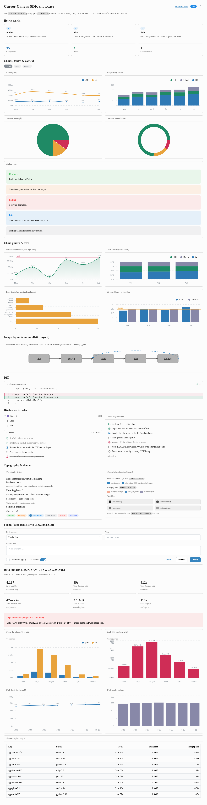
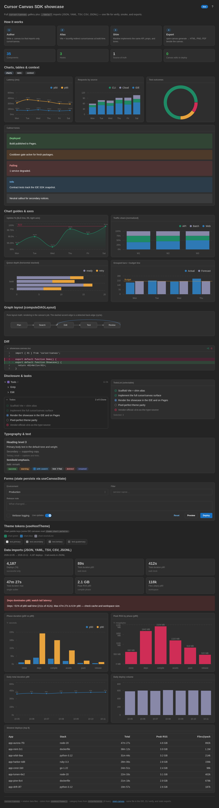

# open-canvas

**Charts, tables, and structured visuals agents can one-shot** — from a single `.canvas.tsx` file to HTML, PNG, PDF, JPG, or an IDE-ready canvas. Same `cursor/canvas` primitives as Cursor Canvas; **no Cursor app required** to build or export.

**Live example:** [light](https://flesler.github.io/open-canvas/) · [dark](https://flesler.github.io/open-canvas/dark.html)

<p>
  
  
</p>

## Install

```bash
npm install -g @flesler/open-canvas
```

PNG, PDF, and JPG use headless Chromium (installed on first `generate`).

### Agent skill

```bash
open-canvas skill ~/.cursor/skills/open-canvas
```

Installs the open-canvas skill, Cursor canvas reference, and SDK types from `@flesler/cursor-canvas-web`.

## Author a `.canvas.tsx`

One React file: charts, tables, callouts, forms — import only from `cursor/canvas`. Static data can live in sibling `./data/*` files. Saved toggles and form state can live in `<stem>.canvas.data.json` beside the canvas (same keys as `useCanvasState`).

```tsx
import { Stack, H1, BarChart } from "cursor/canvas";
import report from "./data/report.json";
```

## Generate

```bash
open-canvas generate path/to/report.canvas.tsx
open-canvas verify path/to/report.canvas.tsx
```

|Command|Purpose|
|---|---|
|`generate <canvas>`|HTML, PNG, PDF (default) into `./out`|
|`verify <canvas>`|Typecheck `cursor/canvas` and data imports|
|`skill [dir]`|Print or install the agent skill bundle|

|Flag|Default|
|---|---|
|`--out`|`./out` beside the canvas|
|`--theme`|`light` or `dark`|
|`--formats`|`html,png,pdf` — also `jpg`, `cursor`|
|`--name`|Output basename (default: canvas stem)|
|`--width` / `--height`|Viewport (`1280`×`900`); exports use full page height|
|`--selector`|Export only matched sections|
|`--inline-state`|With `cursor`: embed `.canvas.data.json` in the emitted file|

Exports read `.canvas.data.json` when present. `--formats cursor` inlines `./data/*` into one file for the IDE; add `--inline-state` to include saved UI state too.

## License

MIT — [LICENSE](LICENSE).
